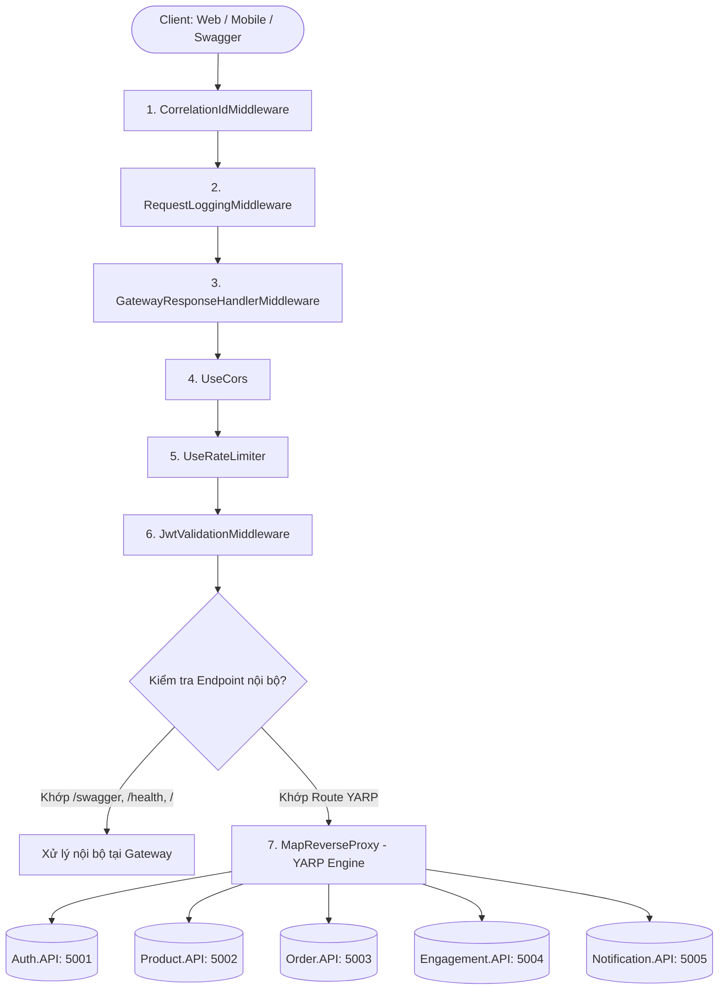

# 🏗️ Cấu Trúc Dự Án API Gateway (Architecture & Directory Structure)

Tài liệu này mô tả chi tiết tổ chức mã nguồn, cấu trúc thư mục và kiến trúc luồng xử lý (Request Pipeline) của **ApiGateway** trong hệ thống **LowLand Coffee**.

---

## 1. Sơ Đồ Cấu Trúc Thư Mục

```text
src/backend/gateways/ApiGateway/
├── docs/                                   # Tài liệu kỹ thuật chi tiết của API Gateway
│   ├── 01-architecture-structure.md        # [File này] Cấu trúc mã nguồn & kiến trúc Pipeline
│   ├── 02-user-guide.md                    # Hướng dẫn chạy, cấu hình và kiểm thử
│   └── 03-gateway-mechanisms.md            # Mô tả chi tiết 9 cơ chế hoạt động của Gateway
├── Extensions/                             # Các Extension Methods mở rộng cho IServiceCollection
│   └── GatewayServiceExtensions.cs         # Cấu hình CORS tập trung và Partitioned Rate Limiting
├── Middleware/                             # Các Middleware xử lý trong HTTP Request Pipeline
│   ├── CorrelationIdMiddleware.cs          # Quản lý & gán X-Correlation-Id cho Distributed Tracing
│   ├── RequestLoggingMiddleware.cs         # Ghi log tập trung, giám sát latency & status code
│   ├── GatewayResponseHandlerMiddleware.cs # Bắt lỗi downstream (502, 503, 504) chuẩn hóa ApiResponse<T>
│   └── JwtValidationMiddleware.cs          # Xác thực chữ ký JWT, chống Header Spoofing & forward context
├── Models/                                 # Các Data Models sử dụng nội bộ tại Gateway
│   ├── ApiResponse.cs                      # Chuẩn cấu trúc phản hồi (Response Envelope) thống nhất
│   ├── GatewayStatusResponse.cs            # Model phản hồi trạng thái chẩn đoán tại route "/"
│   └── RateLimitRule.cs                    # Model định nghĩa quy tắc Rate Limit từ file JSON
├── RateLimits/                             # Thư mục chứa cấu hình Rate Limit độc lập theo Service
│   ├── default.ratelimit.json              # Hạn mức mặc định (100 req/60s)
│   ├── auth.ratelimit.json                 # Quy tắc riêng cho Login, Register, OTP
│   ├── product.ratelimit.json              # Quy tắc riêng cho Catalog & Products
│   ├── order.ratelimit.json                # Quy tắc riêng cho Tạo đơn hàng & Thanh toán
│   ├── engagement.ratelimit.json           # Quy tắc riêng cho Vouchers & Loyalty
│   └── notification.ratelimit.json         # Quy tắc riêng cho Notifications & Broadcast
├── Properties/
│   └── launchSettings.json                 # Cấu hình port chạy local (HTTP 8080)
├── appsettings.json                        # Cấu hình logging, CORS allowed origins, JwtSettings
├── appsettings.Development.json            # Cấu hình môi trường phát triển
├── yarp.json                               # Cấu hình độc lập cho YARP (Routes & Downstream Clusters)
├── Dockerfile                              # Multi-stage Docker build cho Gateway
├── Program.cs                              # Composition Root khởi chạy ứng dụng & HTTP Pipeline
└── ApiGateway.csproj                       # Định nghĩa project file và package dependencies
```

---

## 2. Kiến Trúc Luồng Xử Lý (HTTP Request Pipeline)

Tất cả các request từ ngoài Internet (Frontend Web, Mobile, Third-party) đều phải đi qua Gateway và được xử lý theo thứ tự nghiêm ngặt trước khi forward đến Microservice:



### Thứ tự & Trách nhiệm từng bước trong `Program.cs`:

1. **`CorrelationIdMiddleware`**:
   - Kiểm tra `X-Correlation-Id` từ client gửi lên. Nếu chưa có, tự sinh `Guid` mới.
   - Gắn vào Response Header và mở `_logger.BeginScope` để mọi dòng log trong request đều có trace ID.

2. **`RequestLoggingMiddleware`**:
   - Bắt đầu đo `Stopwatch`.
   - Log thông tin request đầu vào (`Method`, `Path`, `ClientIp`).
   - Khi request hoàn tất, log thời gian phản hồi (`elapsedMs`) kèm màu/level tương ứng (`2xx` -> Info, `4xx` -> Warning, `5xx` -> Error).

3. **`GatewayResponseHandlerMiddleware`**:
   - Bọc toàn bộ pipeline trong `try-catch` để bắt lỗi chưa xử lý (500).
   - Kiểm tra tính năng `IForwarderErrorFeature` của YARP: Nếu downstream die hoặc timeout, chuyển đổi các mã `502 Bad Gateway`, `503 Unavailable`, `504 Timeout` thành cấu trúc `ApiResponse<T>` chuẩn.

4. **`UseCors`**:
   - Áp dụng chính sách `GatewayCorsPolicy` (đọc từ `Cors:AllowedOrigins`), cho phép `AllowCredentials` để phục vụ Cookie và kết nối SignalR Hub.

5. **`UseRateLimiter`**:
   - Áp dụng `PartitionedRateLimiter` phân vùng theo `Client IP + Method + Path`.
   - Nếu vượt ngưỡng, từ chối ngay lập tức với HTTP 429 và thông báo tiếng Việt chuẩn `ApiResponse<T>`.

6. **`JwtValidationMiddleware`**:
   - **Chống Spoofing**: Xóa bỏ mọi header `X-User-Id`, `X-User-Role`, `X-User-Email` client tự ý gửi lên.
   - **Xác thực chữ ký**: Đọc Bearer token (hoặc `access_token` query từ WebSocket), verify chữ ký với `JwtSettings:SecretKey`.
   - **Enrich Claims**: Bóc tách `userId`, `role`, `email` và gán lại vào Headers để chuyển tiếp an toàn xuống Microservice.
   - **Giữ nguyên Authorization**: Vẫn giữ nguyên Bearer token để downstream microservice có thể dùng `[Authorize(Roles = "...")]` chuẩn ASP.NET Core nếu muốn.

7. **Endpoints Nội Bộ & YARP Reverse Proxy**:
   - `/swagger`: Cổng tài liệu OpenAPI hợp nhất của cả 5 service.
   - `/health`: Health check endpoint theo chuẩn ASP.NET Core.
   - `/`: Dashboard chẩn đoán trả về danh sách routes, clusters và uptime.
   - `MapReverseProxy()`: Forward socket và streaming response từ downstream về client.
